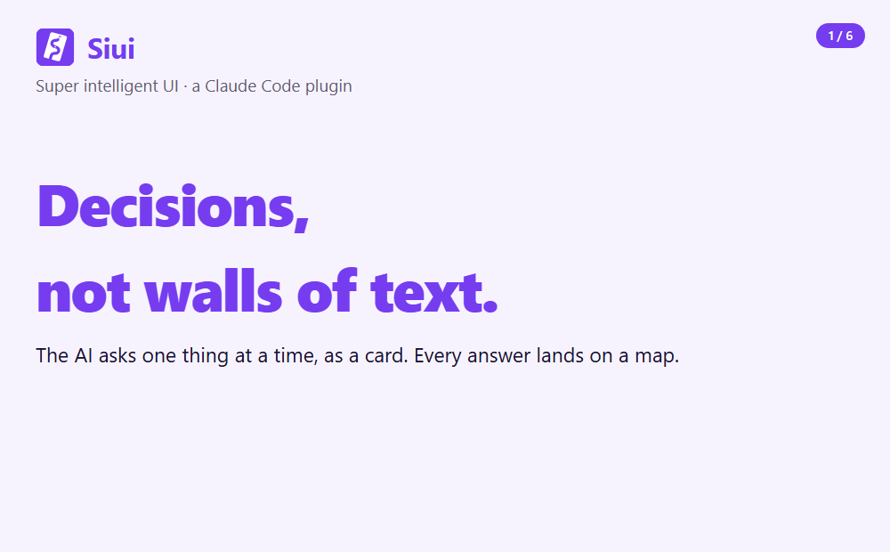

#  Siui

> **Status: beta.** Siui works day to day for its author. A review in November 2026 found
> security and data-safety issues. The security findings are addressed and the board has
> tests; the rest of the data-safety work is under way, and the plugin's own logic has no
> tests yet. Until 1.3.0, use it on your own machine and with projects you trust.

Siui is the Claude Code plugin marketplace `siui`: mods that are easier on the eyes.
Siui (Super intelligent Ui) is its plugin: the assistant's questions drawn as decision
cards, one at a time, in levels and worlds like a game, with a board that maps the run.
decision-cards is the skill, kept outside the plugin in `skills/decision-cards/`: the
rules and the record, which also work with no plugin at all. The plugin ships one pack,
`scaffold`, for a new project; a project writes its own.



## Quick start

```
/plugin install siui --marketplace wajihkm/siui    one step: the marketplace and the plugin
/plugin marketplace add wajihkm/siui               or in two: the marketplace, from GitHub,
/plugin install siui@siui                          then the plugin
```

From a clone instead: `git clone https://github.com/wajihkm/siui.git`, then
`/plugin marketplace add` with the clone's folder and the same install line. Then, in a
project:

```
/siui on scaffold            the first card of the "new project" pack; a pack is a
                             markdown file of levels and cards, and the plugin ships one
                             answer each card: a button, or your own words under Other
/siui board                  the board in the browser: roadmap, maps, steps, files
```

The plugin's page, [siui/README.md](siui/README.md), has the card, the tools,
every command, the board, the universes, the record and the configuration.

## Requirements

- A current Claude Code (the plugin API is early-access and the board was built on
  2.1.310): the VS Code extension, the desktop app or the terminal.
- Python 3 on PATH, for the board (standard library only): `python3`, `python` or
  `py -3`, the first that answers; `SIUI_PYTHON` in your environment names another.
- `git`, for checkpoints and forks; without it the cards and the board still work.
- A browser, for the board.
- Linux, WSL, macOS or Windows. No Unix shell is needed: the board's steps run through
  one Python launcher. Built and used daily on WSL in VS Code, and run in full sessions in
  the Claude desktop app on Windows and on a second WSL machine; macOS is untried.

## What makes it different

- Cards: one decision at a time, two to four options with their consequences, the
  recommended one marked, an explanation behind a button. Nothing to read between cards.
- Every decision shows its files: the ones whose facts drove it and the ones the answer
  will change, as links and as a graph, solid when the assistant really read the file in
  this session, dashed when it only guesses, dotted for a file not there yet. The record
  keeps them, so later you can see what each answer touched and why.
- Worlds: a pack turns a task into levels of three or four cards; the last level is the
  boss, where everything decided is reviewed and applied at once. Nothing is generated
  before the boss.
- The board: a local page that draws the roadmap of worlds, the world map, each stage as a
  side-scrolling level and each step with its decisions, notes, files and the chat around
  it; cards are answered there while it is open.
- Cost: what each decision, stage and world cost, read off the session's own ledger, on
  the board and in the exports; the model and the session's usage beside the chat's state.
- Auto-pilot: a card with a recommendation is answered with it after a countdown; a boss,
  a bug, a problem or a card without advice waits for you.
- Checkpoints: save points, a git commit of the project's folder, drawn on the stage; new
  files only once you agreed, never one that looks like a secret; returning to one tags
  what is there first, so nothing is lost.
- Forks: a stage splits into two roads, each a git branch, the remaining cards asked on
  each; the castle merges the road kept and tags the other.
- Universes: the board's words, icons, colours and shapes from one set, twelve shipped and
  any number of your own.

## The skill without the plugin

`skills/decision-cards/SKILL.md` is the same protocol for an assistant that has no card
tool: the rules, a text card format, the record and the pack format. Copy the folder into
a project's `.claude/skills/` or into `~/.claude/skills/`; the packs it runs are the
plugin's `scaffold` or your own.

| Part | Where |
|---|---|
| The plugin | [siui/](siui/README.md) |
| Why, benefits and features | [FEATURES.md](FEATURES.md) |
| The skill | [skills/decision-cards/SKILL.md](skills/decision-cards/SKILL.md) |
| The pack format | [skills/decision-cards/packs/README.md](skills/decision-cards/packs/README.md) |
| The bundled pack | [siui/packs/scaffold.md](siui/packs/scaffold.md) |

## License

MIT, see [LICENSE](LICENSE). Copyright 2026 Wajih Kammoun.
