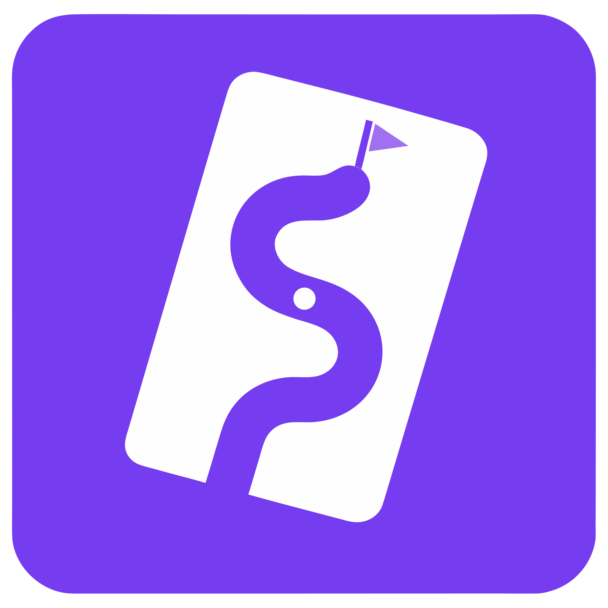

#  Siui

Siui, Super intelligent Ui: a Claude Code plugin. It gives the model one way to ask: a
decision card. The card is drawn inside Claude Code's own question dialog, so it works
wherever that dialog works: the VS Code extension, the desktop app, the terminal.
Decisions come one at a time, grouped in levels and worlds like a game, and go into a
record in the project; a local board draws the roadmap, the maps and every step.

## Quick start

```
/plugin install siui --marketplace wajihkm/siui
```

Or in two steps, `/plugin marketplace add wajihkm/siui` then `/plugin install
siui@siui`; from a clone, `/plugin marketplace add` with the clone's folder first. Then,
in a project:

```
/siui on scaffold            the first card of the bundled "new project" pack
/siui on                     the mode for whatever you describe next
/siui board                  the board in the browser
```

Every `/siui` command also answers to `/game`. A pack is a markdown file of levels and
cards; the plugin ships one, `scaffold`, which sets up a new project, and a project
writes its own. Answer each card with a button, or type your own words under Other; `?`
there opens the explanation. The record grows in `.claude/decisions.json`.

## Requirements

- A current Claude Code (the plugin API is early-access and the board was built on
  2.1.310).
- Python 3 on PATH, for the board (standard library only): `python3`, `python` or
  `py -3`, the first that answers; `SIUI_PYTHON` in your environment names another.
- `git`, for checkpoints and forks; without it the cards and the board still work.
- A browser, for the board.
- Linux, WSL, macOS or Windows. No Unix shell is needed: the board's steps run through
  one Python launcher. Built and used daily on WSL in VS Code, and run in full sessions in
  the Claude desktop app on Windows and on a second WSL machine; macOS is untried.

## The commands

- `/siui on [pack]` turns the mode on and starts the pack's first card, or, without a
  pack, waits for a task to turn into levels.
- `/siui off` leaves the mode.
- `/siui status` draws the world map: the levels along a path, done, current and ahead,
  with the answers under each, and ends with the next card to present.
- `/siui board [link|off]` opens the board in the browser; `link` prints the address that
  holds the board's key, for a bookmark or the editor's own browser; `off` stops its
  server.
- `/siui pane [off]` opens the same map in a pane beside the chat that redraws after every
  decision (in VS Code the pane sits above the prompt); `off` closes it.
- `/siui auto [on|off]` switches auto-pilot; without a word it toggles.
- `/siui checkpoint [title]` saves a checkpoint on the current stage.
- `/siui fork [level]` forks the stage (the current one when unnamed) into roads a and b.
- `/siui road a|b` puts that road on disk.
- `/siui merge a|b|both` merges the forked stage: a merge commit into the base
  (`--no-ff`), the other road tagged `forks/<level>-<road>-<date>-<time>`, the kept road's
  branch deleted; with `both`, road b survives as a branch.
- `/siui back` takes the last decision back and presents it again; never past an applied
  world.
- `/siui reset` closes the run as abandoned and keeps its answers.

## The card

Top to bottom: the level line (`1-2 Structure · card 2 of 4`), the title, one line on
what is decided and why now, the model's note when it answers a question of yours, the
`Explain`, `Show graph` and `Board` buttons, the consequences of each option with the
recommended one starred, what remains in the level, the graph when open, the sources line,
then the option buttons.

- **Explain** opens the hidden explanation; typing `?`, `explain`, `help`, `why` or
  `more` under Other does the same without a round trip.
- **Show graph** opens the drawing of the decision's files, top to bottom: the inputs
  (files whose facts drive the decision), the decision as a cloud, the outputs (files the
  answer will change). This is the heart of a card: before you answer, you see what the
  question rests on and what your answer will touch. An edge is solid when sure, dashed
  when it only might apply, dotted for a file that is not there yet; a file node grows
  with the file's size on disk, up to a limit. The toggle stays as you left it on the next
  cards. The board shows the same graph under every decision in the step, with "changed"
  once an output's file is newer than the answer, and a tree of every file a stage or a
  world touched.
- **Board** opens the board; the same button sits on each card's row in the transcript.
- **Sources** are `file:` links: `In:` the inputs, `Out:` the outputs, `━━` solid and
  `┄┄` dashed. An input the model claims to have used draws solid only when the plugin saw
  the model read the file in this session; otherwise it is downgraded and the model is told.
- **Pictures**: when a choice is visual (a layout, a shape, a colour), each option may
  carry a small drawing; it shows beside the option's own line, in the chat and on the
  board.

The card names its world and stage. The terminal gets a compact card (twelve rows at
most): no buttons, no graph, the option labels in one line. A decided card leaves one dim
line in the transcript, not a tool dump. While the mode is on, a system-prompt section
holds the model to the protocol of the skill and its own AskUserQuestion is closed.

## The board

`/siui board` starts a small local server (`board/server.py`) once per project and opens
its page in the browser. The page shows, top to bottom:

- The **roadmap**: every world as a tile on a road, solid between a world finished and
  the next started straight after, dashed where a world was abandoned or still open,
  dotted toward the predicted next world (the first pack not run yet); a tile glows while
  at work, carries a progress ring, a fork badge when a stage is forked, a flag when
  finished, and is hatched with a themed mark when abandoned; warp pipes between worlds
  draw as arcs; the side quests sit in a corner disc. Packs not run yet show as dashed
  worlds with a Start button. A "+ New world" button opens a dialog (a title, what the
  world is about, and whether the chat writes a pack first or runs ad hoc) that asks the
  chat to start it.
- The **world map**: the stages of the shown world along a path, done, here and ahead,
  the roads of a forked stage above and below the line.
- The **stage**: the selected level drawn as a side-scrolling level, one block per card
  along the ground, ticked once answered and dashed while ahead, a pit for a skipped card,
  what popped up placed where it appeared in time (bugs, problems, jumps and save points
  on the ground, features and checks in the air), the boss's castle or the finish flag at
  the end. A block opens its decision in the step; a jump's pipe goes where it leads; a
  Fork button and the road switch sit in its header.
- The **step**: the selected level's decisions with their answers and time, each a
  folding card with its graph of inputs and outputs, a note box saved into the record (or
  saved and sent to the chat as your words), a ▤ button that reads the chat's output that
  followed, Move for a chat, skipped or side-quest decision, the chat turns around the
  step collapsed, the files touched as a tree with folding folders, every file a link that
  opens it in VS Code (with no `code` command on the machine its folder is shown instead;
  the board never runs a file), and a form to add a mark by hand.
- The **side panel** (its toggle is named by the universe: Controller in classic and
  mario, Compass, Helm…): the live card with its options, where you are, the open marks,
  lately, the save point and a box that sends text to the chat as your own words. It
  docks beside the page or floats as a drawer, a toggle kept across visits.
- The **bottom bar**: the chat's state (working, idle, waiting for you, ended, not
  running), the page's liveness, a ✔ Ready chip when a thing was built (it selects the
  decision and reads the output), the ⌨ switch that keeps cards in the chat dialog while
  the page is open, ⏵ auto for auto-pilot, the sound (a short chime when a card waits),
  the scheme (light, dark, or the system's), the universe menu, ⇩ Export, and ⓘ the
  legend of every icon, line and status. Export writes the project's roadmap into
  `.claude/exports/roadmap-<date>-<time>.<ext>`: a standalone HTML page (the roadmap,
  every world's map and its decisions, folded), a Markdown report (a section per world, a
  table per stage) or an SVG poster (the roadmap drawing alone), in the universe's words
  and colours; opening the page at `/#export=html`, `md` or `svg` runs one export at
  once, for a script.

While the page is open, cards are answered on it: the live card shows with its options,
and the chat only says the card is waiting on the board; the ⌨ switch keeps them in the
chat instead. Close the tab and the next card comes back to the chat dialog. Keys: 1 to 4
answer the card, j and k walk the steps, / focuses the send box, f the search, Escape
leaves a box; tiles, stops, blocks and rows take focus and Enter opens them. Search in the
header covers decisions, marks, levels, worlds and chat turns.

The server is the Python 3 standard library, bound to 127.0.0.1, and it answers only to
the holder of the board's key: a random value in the run folder, which you alone can
read. Another program or another person on the machine can reach the port, but can
neither read the board nor answer a card nor write to your chat. `/siui board` opens the
page with a one-time pass, the page trades it for the key, and the browser keeps the key,
so the plain address works in that browser from then on; a browser that was never given
the key says so and names the command. A call also needs a localhost Origin or Host, and
a POST a JSON content type, so no website can reach it; the page is sent with a content
security policy that runs its own two scripts and nothing else. What a project's files
say (the record, a card, a universe file) is drawn as text and never as markup, and a
prompt the board sends to the chat carries ids, not titles.
Runtime files (the key, the live card, the inboxes, the liveness marks) live under
`~/.cache/siui/<project>/`, made 0700 (on Windows `%LOCALAPPDATA%\siui\<project>\`), never in the project. `/siui board off`
stops the server; it also stops by itself a few minutes after the session ends.
`boardPort` in the configuration picks the port (5131 by default, then the next nine).

To have the board inside VS Code instead of the browser, open it in the Simple Browser:
the command palette, "Simple Browser: Show", then the address; or a key bound to
`simpleBrowser.show` with the address as its argument. Nothing on the command line can
open that view, so the plugin opens the system browser. The Simple Browser needs the key
once, like any browser: `/siui board link` prints the address that holds it, and that is
the address to give the palette or the key binding. The link is as good as the key: keep
it to yourself.

## Packs

A pack is one markdown file: a world, its fixed facts, its levels, and for each level its
cards (id, title, options with the recommended one first) and its sources, the inputs to
read before the level's first card and the outputs the level's answers will change; the
last level is the boss. The pack gives the skeleton; the model writes the short line, the
effects and the explanation from what it reads in the project. The format is in
[../skills/decision-cards/packs/README.md](../skills/decision-cards/packs/README.md); the
plugin ships one pack, [packs/scaffold.md](packs/scaffold.md): identity, stack, structure
and quality of a new project, then the boss creates the files decided.

`/siui on <pack>` looks for the pack in four places, in order: the project's
`.claude/skills/decision-cards/packs/`, the folders the configuration names under `packs`
(relative to the project, or absolute), the plugin's `packs/`, then
`~/.claude/skills/decision-cards/packs/`. The number in a pack's name is a suggestion; a
run takes the project's next world number.

## The universes

The board follows a universe, one set of words, icons, colours and shapes, chosen per
project; the chat's card header and world map follow the same words. Twelve ship in
`board/universes/`:

| Set | Its world |
|---|---|
| `classic` | the quiet default: worlds, stages, castles and warp pipes |
| `mario` | the classic look grown up: levels, castles, Goombas, mushrooms, coins, flags, a playful voice |
| `mountain` | mountains, areas, climbs, a summit |
| `sea` | seas, islands, voyages, a lighthouse |
| `cloud` | skies, clouds, flights, a thunderhead |
| `space` | galaxies, planets, missions, a mothership |
| `fire` | volcanoes, craters, sparks, an eruption |
| `software` | epics, stories, tasks, a release |
| `kitchen` | menus, courses, recipes, a tasting; a tiled counter |
| `railway` | lines, stations, tickets, a terminus; rails and sleepers |
| `garden` | plots, beds, seeds, a harvest; soil rows |
| `zoo` | parks, enclosures, animals, a lion |

A set file is one JSON object: `name` and `title`; `about`, one line; `words` (`world`,
`stage`, `step`, `card`, `boss`, `roadmap`, with plurals when irregular); `events`, the
game names of the six kinds (`enemy`, `powerup`, `challenge`, `check`, `pipe`,
`checkpoint`); `statuses`, game words for the six statuses, shown in tooltips (optional);
`voice`, the toasts and captions (optional); `glyphs` and `worlds`, the icons, SVG in a
24-unit box; `palette.light` and `palette.dark`, CSS variables; `shapes` (`tileRx`,
`tileMotif`, `linkMotif`, the world map's `route`, the stage's `scene`: field, hills,
slope, waves, stars, clouds, embers, lanes, tiles or rails); and `toggle`, the side
panel's name and icon. The menu in the board's bottom bar switches the set and writes
`theme.universe` into the configuration. A project's own set is the same JSON dropped in
its `.claude/universes/` folder; it is listed beside the shipped ones and wins over a
shipped one of the same name.

## The record

`.claude/decisions.json` holds every run, so the maps and `/siui status` read it and a run
resumes after a restart. `format` is 1. Each run has an `id` (`<project>/world-<n>`), the
`target`, the `pack` (`ad-hoc` without one, `side` for the side quests), the `world`
number, `startedAt`, `finishedAt` (null while open) and `abandonedAt` when reset, the
`levels` with their state, `levelTitles`, `levelCounts`, the pack's `plan`, the
`decisions`, and `roads` for the stages forked.

A decision carries its `level`, `id`, `title`, `answer`, `isOther` (your own words), `at`
and `sources` (path, role in or out or both, use used or maybe). `via` says how it came:
absent or `card` for an answered card, `chat` for a decision recorded by the `note` tool
(with `why`), `auto` for auto-pilot, `skipped` for a dismissed card; the last three count
toward no level. `note` and `notes` hold what you typed on the board. Three flags mark
the work: `queued` (decided, not started), `started` (taken out of the queue), `built`
(work followed in the same turn).

`events`, a top-level list beside `runs`, are what popped up: `id`, `kind`, `title`,
`text`, `world`, `level`, `at`, `status` open or done with `doneAt`, `size`, `to` for a
pipe, `commit` and `branch` for a checkpoint.

Decisions after a boss go by topic: a card or a note that names a stage of a finished
world joins that world; any other goes to the side quests, world 0, a run that never
finishes, its stages one per month (level `0-YYYYMM`), drawn apart on the roadmap. A
card naming a world that is not in the record goes there too.

A forked stage's entry under `roads` keeps the `level`, `at`, the `base` branch, the
`checkpoint` commit, the `branches` a and b, the road `onDisk`, and once the castle
decided, `merged` (`a`, `b` or `both`) and the `tag` of the other road.

The plugin and the board's server both write the record: each re-reads it, merges and
writes by rename. An unreadable record is kept aside under a dated name
(`decisions.json.broken-*`) and a fresh one starts. The chat log,
`.claude/chat-log.jsonl`, keeps one line per turn with your words, the answer cut short
and the level current at the time, so the board shows the turns around each step; past
2 MB it is archived under a dated name beside it. The record is the project's own and is
meant to be committed. The chat log holds your prompts and is this machine's: it is
written only while the mode is on, and a `.gitignore` beside it, written once under a
marked line, keeps it and the record's leftovers out of git; the exports folder has one
of its own. Deleting a line under the mark is how you commit one of them after all.

A decision also keeps its `cost`: what the session spent, in dollars at API prices, from
that answer to the next one, read off the session's own ledger at each answered card and
each turn's end. The board sums it per stage and per world, with each part's share of the
world in the tooltip, and the HTML and Markdown exports carry it: a Cost column on the
cards, a figure on each stage and world, a total under the title. It is counted from the
plugin's first reading in a session, by time and not by cause, and is absent where the
host keeps no ledger.

The board also names what the chat runs on: the model beside the chat's state in the
header, and in the "Where you are" panel a Model row and a Usage row with the session's
cost so far, how full the context window is, and each rate-limit window with its reset.

## Configuration

`.claude/siui.json` in the project, every field optional:

```json
{
  "name": "Beacon",
  "record": ".claude/decisions.json",
  "caps": { "explain": 300 },
  "packs": ["docs/packs"],
  "boardPort": 5131,
  "chatLog": ".claude/chat-log.jsonl",
  "extended": true,
  "theme": {
    "scheme": "toggle",
    "accent": "blue",
    "contrast": "moderate",
    "tones": "default",
    "font": "system",
    "size": 17,
    "density": "comfortable",
    "corners": "pill",
    "motion": "all",
    "edges": "dashes",
    "map": "wave",
    "universe": "classic"
  }
}
```

- `name` is the project's name in the board's header; left out, the folder's name.
- `record` moves the decisions file; `chatLog` moves the chat log; both stay inside the
  project.
- `caps` lowers a field cap (never raises one: the dialog allows 48 rows).
- `packs` adds up to eight folders where `/siui on <pack>` looks for packs, after the
  project's skill folder and before the plugin's bundled one.
- `boardPort` is the board server's first port (1024 to 65535).
- `extended` set to `false` turns the stage, the "extended game mode", off on the board.
- `hiddenPacks` names the packs the roadmap does not draw as planned worlds; the board's
  Hide button on a planned world writes it, its hidden button clears it.
- `theme` is written by the theme world's boss and the board's menu. The page applies
  `scheme` (`light` or `dark`; anything else follows the system; the page's own ◐ button
  overrides it and is kept), `size` (the base text size in px), `corners` (`pill`, `soft`
  or `square`), `motion` (`all`, `reduced` or `none`; the page honours the system's
  reduced-motion setting whatever it says) and `universe` (one of the twelve, or a
  project's own). `accent`, `contrast`, `tones`, `font`, `density`, `edges` and `map` are
  recorded only, the theme world's answers for its next run, and not applied.

## Tools the model gets

- `card`: one decision; the fields are capped (title 60 characters, short 120, explain
  480, option label 30, effect 80, remaining 80, note 200, up to 4 options and 6 sources).
  `kind` is `decision`, `info` (fixed facts, one option "OK") or `boss` (the level
  review); `mark` (`bug`, `feature`, `problem`, `check`) makes the card land on the map
  when answered. Its result is the chosen label or the user's own text, or `dismissed`.
- `done`: closes the world after the boss card was applied and returns one summary line
  per level, for the model to append where the pack says. On a world with a forked stage
  still open it takes `merge`: the road kept, `a` or `b`, or `both`. With no boss card
  answered on the last level it asks the model to check with you first; `confirm: true`
  then closes the world without a castle.
- `note`: records a decision you took in the chat rather than on a card, with its level,
  the reason and an optional `mark`; it shows on the board beside the cards, collapsed,
  and counts toward no level.
- `event`: drops something that popped up while building on the map, on the stage where
  it appeared, in plain words: a bug or risk, a feature, a problem, a check, a jump to
  another stage or world (`to`), a save point; in the game, an enemy, a power-up, a
  challenge, a coin (the game's name of a `check`), a warp pipe, a checkpoint. `size` 1
  to 5 grows its icon. The same tool, with the id and `status: "done"`, marks it done.
- `fork`: `action: "fork"` takes a checkpoint and makes two git branches,
  `fork/<level>-a` and `-b`, with road a on disk and the stage's remaining cards asked as
  level `<level>a`; `"road"` switches the disk to road `a` or `b`; `"merge"` keeps `a`,
  `b` or `both`.

A checkpoint is a save point: a commit of the project's folder on your current branch,
made by the tool, by `/siui checkpoint [title]`, by the board's "Save point" button, or by
`done` after a boss is applied; it commits under your own git identity. It takes the
files git tracks. New files are added only after you agreed, once per project: the
question lists them, and the answer is kept in the run folder, outside the project. A
file whose name looks like a secret (`.env`, `*.pem`, `*.key`, `id_rsa`, `.npmrc`,
`credentials.json` and the like) is never added; `git add` it yourself when it belongs.
In a larger repository the other folders, and what you staged there, are left alone, and
in the middle of a merge or a rebase no save point is made. "Return here" on the board
commits and tags what is there now (`checkpoints/before-<time>`, new files too, so
nothing is lost), resets the tree to the save point, puts the record and the chat log
back, and tells the chat.

## Developing

The checks are the plugin validator, run from the repository root with the `claude` CLI,
and the tests under `tests/`, which need only Python's standard library:

```
claude plugin validate siui --profile directory
python3 -m unittest discover -s tests
```

The tests serve the real page a hostile record, card and universe and walk it in a
headless browser, looking for anything that came alive; and they start the real server
and ask it as a caller that is not its page would. The page tests need Chrome, Chromium
or Edge (`SIUI_TEST_BROWSER` names one) and are skipped without it. The hooks have no
tests of their own yet, and there is no linter or CI.

While developing, a symlink to `siui/` in a session's `~/.claude/dev-mods/<session>/`
folder hot-reloads on save. The engine lays its API types in `.claude-plugin/types/` at
every load (ignored by git), which `tsconfig.json` extends for the editor. A release is
one git tag, the plain version (`1.1.0`), made with `git tag -a <version>`, the manifest bumped
with it.
